# Results

Rust prototype, CPU or GPU tracer (wgpu/Vulkan, statistically identical results), diffuse box scene, 192×96 px. All
numbers are **relMSE** against a 4096 spp per pixel reference, as mean ± standard deviation over **5 seeds** (3 for
scaling). Equal budget for every method: 1 path per surface pixel per frame. Differential paths are counted and paid back
over the following frames. To reproduce: `cargo run --release -- all`, then `cargo run --release -- scale` and
`python tools/plots.py`.

## TL;DR

1. **At equal budget, KRC divides the error by 3 compared with the best classic cache and by 21 compared with
   accumulated path tracing** on a dynamic sequence (4.1e-3 against 1.25e-2 and 8.9e-2).
2. **A static scene costs almost nothing**: in target-quality mode, it drops to ~0.01 path/pixel/frame once converged,
   the exploration floor.
3. **The cost of a moving object follows the change, not the scene's size.** From 2 to 8 rooms, KRC's cost while the box
   moves *goes down* (16 k → 10 k paths/frame), while the cache with reset goes from 42 k to 165 k (∝ N).
4. **What makes the difference is not the dependency graph**: it is the **differential update through correlated
   paths**. The graph only reduces the cost, and only for localised changes.
5. **Light changes become local thanks to energy-weighted dependencies** (§3 bis). At 8 rooms, switching on a lamp costs
   28 k paths instead of 56 k, and that cost no longer grows with the scene beyond the rooms really lit.
6. **The whole pipeline runs on the GPU** (RTX 4070), validated against the CPU, stable over 12,000 frames (§7, §8).
7. **KRC v2 beats NVIDIA's real SHaRC at equal GPU time on dynamic sequences** (§13): 2 to 4× less error on Sponza, fixed
   or moving camera, including against a SHaRC tuned to react fast, and 20 to 27× less on the Cornell box. KRC v2 takes
   cache resampling from SHaRC and keeps its correlated paths and target quality. Still in SHaRC's favour: static with a
   moving camera at 1280×720 (≈2×) and a lower minimum cost (0.9 ms against 3 ms at 1280×720).
   *Before KRC v2* (§12), against the real SHaRC, KRC's advantage came down to **light changes**: over the full sequence,
   3 to 18× less error, almost entirely because SHaRC keeps a switched-off lamp for dozens of frames (7× too bright).
   **In static, fixed or moving camera, SHaRC is as good or better for 3 to 25× less GPU time.** The "2.7 to 2.9× less
   error at equal time" of §9 and §10 were measured against my home-made SHaRC-like cache, much more expensive than the
   real one.
   **Moving camera**: KRC's quality holds (Sponza 3.8e-2 against 2.5e-2 with a fixed camera), but its cost explodes
   (12.6 ms at 0.25 path/px at 1280×720, 1.35 M cells, ~460 MB).
8. **Sponza revealed two biases toward dark** that relMSE rewarded (§11): Neyman allocation dilutes the rare values of a
   heavy-tailed radiance, and cells "without a measured difference" when a small lamp switched on kept their history.
   Fixed; ~3 % static bias remains and a slower return after the main lamp switches off (0.79 → 0.91 in 20 frames, against
   2.45 → 1.56 for SHaRC).
9. **Documented failures**: the verification z-test (underpowered), the initial idea's "objects touched" dependencies
   (false negatives when a lamp switches on), the binary graph facing light (it saturates through doors), two weighting
   attempts (hashed sketch, traversal frequencies), simple amortisation of lamp events, and the uniform defensive share
   against the allocation bias.

## 1. Main sequence (2 rooms, 120 frames)

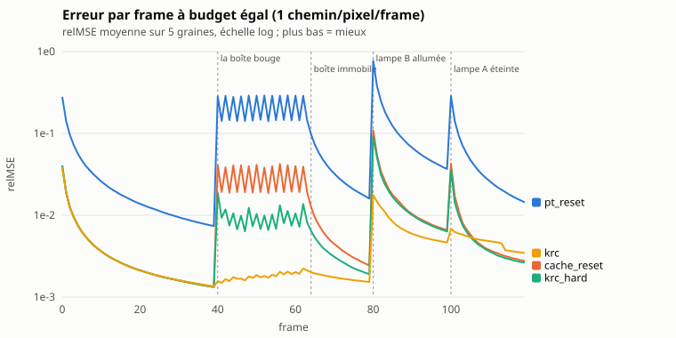

| Method | Sequence | Static | Box moves | Lamp B on | Lamp A off |
|---|---|---|---|---|---|
| `pt_reset` (per-pixel accumulation, reset) | 8.9e-2 | 8.3e-3 | 2.2e-1 | 1.4e-1 | 5.1e-2 |
| `pt_ema` (temporal accumulation) | 6.1e-2 | 1.5e-2 | 3.5e-2 | 6.8e-2 | 1.7e-1 |
| `cache_ema` (SHaRC/DDGI type) | 4.6e-2 | 2.3e-3 | 4.5e-3 | 5.0e-2 | 2.1e-1 |
| `cache_reset` (Neyman + oracle reset) | 1.25e-2 | 1.45e-3 | 3.0e-2 | 2.0e-2 | 7.1e-3 |
| `krc_hard` (dependencies, hard invalidation) | 7.9e-3 | 1.45e-3 | 9.6e-3 | 1.8e-2 | 6.3e-3 |
| `krc_obj` ("objects touched" dependencies, H0) | 5.8e-3 | 1.42e-3 | 1.8e-3 | 1.4e-2 | 8.8e-3 |
| **`krc`** (full H\*\*) | **4.1e-3** | 1.47e-3 | **1.8e-3** | **7.6e-3** | 4.8e-3 |
| `krc_all` (delta everywhere, no graph) | 4.1e-3 | 1.46e-3 | 1.9e-3 | 7.8e-3 | 4.3e-3 |

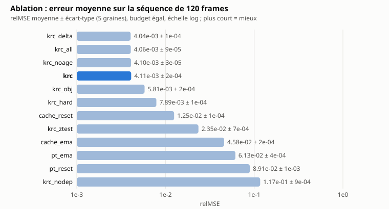

Reading:

- **The cache with Neyman allocation** already beats per-pixel accumulation in static (1.45e-3 against 8.3e-3): the
  variance goes where it matters. The cache keeps a discretisation bias (cells of 2 to 4 px): after a long warm-up, the
  floor is about 6e-4 to 7e-4.
- **Delta against hard invalidation**: 5× less error while the box moves, 2.4× when the lamp switches on. Keeping the
  history and correcting it is worth much more than throwing it away.
- **Spatial dependencies against "objects touched"**: when a lamp switches on, H0 misses the cells (the switched-off lamp
  was never sampled), hence 1.4e-2 against 7.6e-3. The critique of §1.1 of [HYPOTHESIS.md](HYPOTHESIS.md) is confirmed.
- `krc_ztest` (2.35e-2) and `krc_nodep` (1.17e-1): a statistical test on independent samples does not replace a
  correlated measurement, and without any event detection the history stays stale.
- After A switches off, KRC stays slightly above hard invalidation at the end of the sequence. It is not a bias (|bias|
  < 0.6 %) but variance in the room that went dark (see JOURNAL v3): when the history becomes useless, correlated paths
  cost more than a restart.

## 2. Cost in target-quality mode

The allocator samples only cells whose predicted relative error exceeds 3 %, with a cap of 4 paths/pixel.

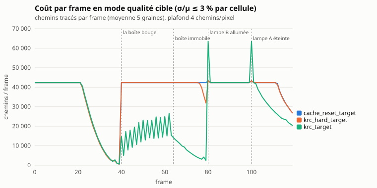

| Method | Paths/frame (mean) | relMSE |
|---|---|---|
| `cache_reset_target` | 37,500 | 3.8e-3 |
| `krc_hard_target` | 37,300 | 2.8e-3 |
| **`krc_target`** | **26,700** | **2.1e-3** |

With 29 % fewer paths, the error drops by 44 %. In static, the cost drops from 42 k to ~300 paths/frame (frames 20 to
39).

## 3. Scaling (2, 4, 8 rooms)

Constant pixel density (96 px wide per room). Events always touch rooms 0 and 1. Warm-up of 150 frames.

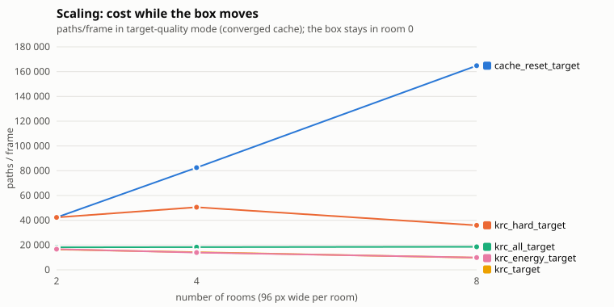

| Target-quality mode, paths/frame | N = 2 | N = 4 | N = 8 |
|---|---|---|---|
| Static (converged cache) | 270 | 400 | 710 (≈ 0.01/px) |
| Box moves, `cache_reset_target` | 42 k | 83 k | 165 k |
| Box moves, `krc_all_target` | 18 k | 18 k | 19 k |
| Box moves, **`krc_target`** | **16 k** | **14 k** | **10 k** |
| Lamps, `krc_target` | 31 to 43 k | 52 to 66 k | 39 to 48 k |

Direct cost of an event (correlated paths):

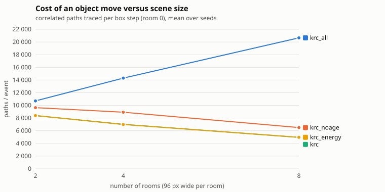
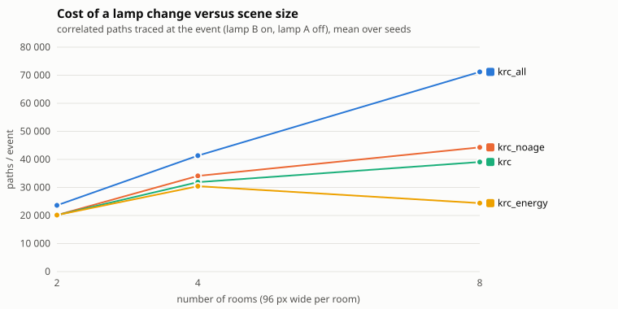

| Correlated paths per event | N = 2 | N = 4 | N = 8 |
|---|---|---|---|
| Move, `krc_all` (no graph) | 10.7 k | 14.3 k | 20.7 k |
| Move, **`krc`** | **8.4 k** | **7.0 k** | **4.9 k** |
| Lamp B on, `krc_all` | 23.6 k | 41.3 k | 71.2 k |
| Lamp B on, `krc` | 20.1 k | 34.9 k | 56.1 k |

Error at equal budget, all phases: at N = 8, `krc` gets 1.6e-3, against 1.8e-2 for `cache_reset` and 4.7e-3 for
`krc_hard`.

Reading:

- **For geometry, the promise holds**: the dependency graph limits the cost to the affected area, and that cost does not
  grow with the scene. **Ageing** of dependencies (a 64-sample window) reduces suspects further: 1,070 against 1,837
  without ageing at N = 8.
- **For light, it does not hold yet.** Room B's lamp really lights, through the door, the walls of rooms 0 and 2. Cells of
  the following rooms depend on those walls through frequent indirect paths. So the graph is qualitatively right: those
  cells do change. But it does not know the change there is tiny. An **energy-weighted propagation** is missing.

## 3 bis. Energy-weighted dependencies

Ground truth (references, N = 8, signed change aggregated per room) when lamp B switches on: rooms 0 to 3 = +4.1 %,
+153 %, +165 %, +1.1 %; rooms 4 to 7 < 0.1 %.

The criterion: a cell is a suspect if its paths cross the changed area **and** if Σ_S f_S · M_S > 1 % of its radiance,
where f_S is the fraction of its recent samples with a **vertex** in super-region S (where light is picked up), and M_S
the radiance change deposited by the lamp's probes.

| N = 8, suspects per room (lamp B on) | 0 | 1 | 2 | 3 | 4 | 5 | 6 | 7 |
|---|---|---|---|---|---|---|---|---|
| Binary graph (`krc`) | 85 % | 83 % | 82 % | 78 % | 77 % | 74 % | 76 % | 78 % |
| **Weighted (`krc_energy`)** | 100 % | 100 % | 94 % | 53 % | 8 % | 1.5 % | 0.3 % | 0.6 % |

| Correlated paths per switch-on | N = 2 | N = 4 | N = 8 |
|---|---|---|---|
| `krc_all` (no graph) | 23.6 k | 41.3 k | 71.2 k |
| `krc` (binary) | 20.1 k | 34.9 k | 56.1 k |
| **`krc_energy`** | 20.1 k | 32.8 k | **27.7 k** |

The error stays equivalent: 3.99e-3 against 4.11e-3 on the main sequence, and 1.57e-3 against 1.61e-3 at N = 8. Memory:
72 bytes of counters per cell.

## 4. Verdict on the hypothesis

| Starting claim | Verdict |
|---|---|
| A static scene converges and ends up costing nothing | ✅ ~0.01 path/pixel/frame (exploration floor) |
| Wins against a standard real-time cache, in ms, on real triangles | ✅ KRC v2 against the real SHaRC: 2 to 4× less error at equal time on dynamic sequences (Sponza), 20× on the Cornell box; ⚠️ static with a moving camera and minimum cost in SHaRC's favour (§13) |
| Holds with a moving camera | ✅ quality; ⚠️ cost (KRC v2: 3 ms minimum at 1280×720, against 0.9 ms for SHaRC) |
| The cost of a dynamic scene follows what changes, not the scene's size | ✅ for objects; ✅ for light with energy weighting (the cost follows the area really lit) |
| A dependency graph by objects touched is enough | ❌ false negatives (lamp switched on, new shadow); regions crossed beat it |
| Invalidate dependent cells | ⚠️ invalidating is expensive; **measuring the delta through correlated paths and correcting** is 2 to 5× better |
| Allocate rays to uncertainty | ✅ Neyman + Bayesian prior; the prior needs a floor (starvation bug found); ⚠️ with heavy-tailed radiance, the variance must be capped, otherwise bias toward dark (§11) |

## 5. Limits of the prototype

- Toy scene: axis-aligned boxes, diffuse materials only, low resolution. Tracing runs on the GPU, but the cache and the
  allocation stay on the CPU.
- Fixed camera: no reprojection or camera disocclusion.
- The cache displays a radiance averaged per cell (discretisation bias of about 6e-4 relMSE); a final render would add
  per-pixel direct lighting.
- Memory per cell: 2 × 432 bytes of region bitset (8-room grid) + 3 accumulators. That is a lot; a serious version would
  use a Bloom filter or hierarchical regions.

## 6. Next leads, by expected value

1. ~~Energy-weighted dependencies~~: done (§3 bis).
2. **GPU-resident cache**: see [ROADMAP.md](ROADMAP.md).
3. **Choose between delta and restart before paying**: when the history becomes useless (dominant lamp switched off),
   correlated paths cost more than a restart. The control variate's β can be predicted from the first m₀ paths.
4. **Specular**: trace through glossy surfaces up to the first diffuse vertex (like NRC/SHaRC), and measure what that costs
   the promise.
5. **Moving camera**, then hardware rays (RT cores).

## 7. GPU (RTX 4070, wgpu on Vulkan)

`cargo run --release -- bench`; full sequence: `KRC_GPU=1 cargo run --release -- all` (results in `results/gpu`).

- **Exactness**: at 256 spp, the GPU/CPU difference (relMSE 2.315e-3) equals the CPU/CPU noise (2.306e-3); the mean
  luminance is within 0.14 %.
- **Exact correlated paths on the GPU**: |L + ΔL − L_old| ≤ 2e-7 (f32 precision).
- **Full sequence on the GPU**: same conclusions as on the CPU, within error bars (`krc_energy` 3.96e-3, `cache_reset`
  1.25e-2, `pt_reset` 8.96e-2).

| Throughput (transfers included) | CPU 16 cores | GPU | Gain |
|---|---|---|---|
| 2.07 M paths (1080p, 1 spp), without dependencies | 1,129 ms | 107 ms | ×10.5 |
| 2.07 M paths, with dependencies | 1,400 ms | 919 ms | ×1.5 |
| Pure compute (64 spp per request) | — | 523 M paths/s | — |

Pure compute would fit 2 M paths in ~4 ms. What costs is the transfers: with dependencies, each path sends ~450 bytes
back to the CPU. Hence the next step: the cache must live on the GPU.

## 8. Fully GPU pipeline

Everything lives on the GPU: G-buffer, hash table of cells, event, correlated paths, allocation, tracing, resolve,
display. The CPU sends the scene and the event, then reads the image back for evaluation only, outside timing.

| Rooms in a row, 1 path/px, median GPU time | Static | Moving box | Switch-on peak |
|---|---|---|---|
| `gpu_sharc` 1920×960 | 3.8 ms | 3.8 ms | 3.8 ms |
| `gpu_krc` 1920×960 | 4.6 ms | 7.0 ms | 10.7 ms |

- Quality identical to the CPU: `gpu_krc` 4.19e-3 against 4.11e-3 for `krc_energy_l2`.
- **Long drift** (12,000 frames): no measurable drift after two fixes (max weight of a corrected estimate, history capped
  at 1,024), `results/gpu/drift.txt`.

## 9. Triangles and hardware ray tracing: comparison in ms against a home-made SHaRC-like cache

> ⚠️ "SHaRC" in §9 and §10 means my SHaRC-like cache (KRC's cells, running average, 1 path per pixel), not NVIDIA's
> SHaRC. Against the real one, see §12.

Cornell box in triangles, Vulkan ray query on the RTX 4070, same 120-frame sequence. Numbers after the bias fixes of §11.
relMSE*: without the worst 0.1 % of pixels; "lum": total image luminance / reference (1 = no bias).

| 256×256, 5 seeds, relMSE* | Sequence | Static | Box | Lamp on | Lamp off |
|---|---|---|---|---|---|
| `tri_sharc` | 3.80e-2 | 1.95e-3 | 7.28e-3 | 3.83e-2 (lum 0.79) | 1.63e-1 (lum 1.59) |
| **`tri_krc`** | **5.20e-3** | **1.43e-3** | **3.19e-3** | **9.21e-3** (lum 0.98) | **6.16e-3** (lum 0.99) |

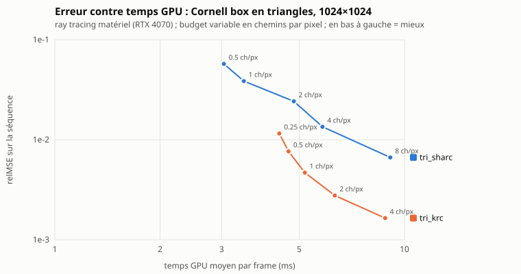

| 1024×1024 | Budget | relMSE* | Mean GPU | Median GPU | p95 |
|---|---|---|---|---|---|
| SHaRC | 4 paths/px | 1.30e-2 | 5.9 ms | 5.8 ms | 6.6 ms |
| SHaRC | 8 paths/px | 6.4e-3 | 9.1 ms | 9.1 ms | 9.3 ms |
| **KRC** | 1 path/px | **4.9e-3** | **5.2 ms** | 4.2 ms | 13.1 ms |
| **KRC** | 2 paths/px | **2.7e-3** | 6.3 ms | 5.4 ms | 13.5 ms |

- **At equal mean time, KRC has ~2.7× less error; at equal error, it is ~1.7× faster.**
- **But KRC's time is not constant.** Event frames cost 12 ms (box step) to 16 ms (lamp), because in a single room
  everything really changes and every cell receives its correlated paths within the frame. SHaRC has a flat cost.
- Amortising lamp events over several frames does halve the peak, but the error grows 2.5× (stale cells displayed): a
  negative result.

## 10. Sponza: a real scene, comparison in ms against the home-made SHaRC-like cache

Sponza (Crytek, 262 k triangles), 4 lamps, a 1.4 m box that moves, same 120-frame sequence: static, the box moves (frames
40–63), the gallery's small warm lamp switches on (80), the large lamp above the atrium switches off (100). References at
16,384 spp. Raw relMSE is unusable here (dominated by a few fireflies, ~70 % spread between seeds): relMSE* without the
worst 0.1 % of pixels is given, with the luminance ratio.

| 480×270, 5 seeds, relMSE* | Sequence | Static | Box | Lamp on | Lamp off |
|---|---|---|---|---|---|
| `tri_sharc` | 9.03e-2 (lum 1.15) | 1.75e-2 | 1.79e-2 | **3.67e-2** (lum 0.92) | 4.02e-1 (lum 1.94) |
| **`tri_krc`** | **2.47e-2** ± 6e-4 (lum 0.96) | **1.31e-2** | **1.29e-2** | 3.91e-2 (lum 0.94) | **3.08e-2** (lum 0.86) |

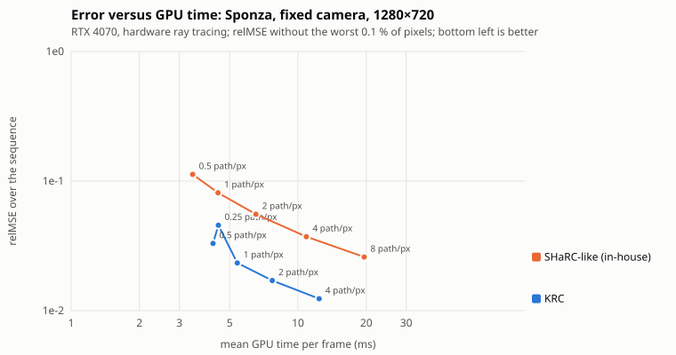

| 1280×720 | Budget | relMSE* | Mean GPU | Median GPU | p95 |
|---|---|---|---|---|---|
| SHaRC | 1 path/px | 8.1e-2 | 4.4 ms | 4.4 ms | 4.5 ms |
| SHaRC | 2 paths/px | 5.5e-2 | 6.5 ms | 6.5 ms | 6.6 ms |
| SHaRC | 8 paths/px | 2.6e-2 | 19.6 ms | 19.7 ms | 19.8 ms |
| **KRC** | 0.5 path/px | **3.3e-2** | **4.2 ms** | 3.4 ms | 8.9 ms |
| **KRC** | 1 path/px | **2.3e-2** | 5.4 ms | 5.1 ms | 9.6 ms |
| **KRC** | 2 paths/px | **1.7e-2** | 7.7 ms | 7.4 ms | 10.8 ms |

- **At equal mean time, KRC has 2.7 to 2.9× less error; to reach KRC's error at 1 path/px (5.4 ms), SHaRC needs 8
  paths/px and 19.6 ms (3.6×).**
- The gain comes mostly from changes: the main lamp switching off (13× less error) and the box. In static, the gap is
  only 1.3×; when the small lamp switches on, SHaRC does slightly better (3.67e-2 against 3.91e-2): its light reaches most
  cells only through several bounces, and 8 correlated paths rarely see it (§11).
- Peaks remain: p95 of 9.6 ms at 1 path/px, against a flat cost for SHaRC.
- Amortising lamp events stays negative (1 path/px: 2.65e-2, p95 9.0 ms).

## 11. Bias toward dark: diagnosis and fixes

Looking at the Sponza images (and not only the relMSE), the KRC image was 2× too dark 20 frames after the large lamp
switched off. Indicator: total image luminance / reference over surface pixels (`krc bias`, `results/bias/`).

**Cause 1: allocation dilutes rare values.** With heavy-tailed radiance (small bright lamp, indirect), a cell that draws a
rare value sees its variance explode and is immediately oversampled: the rare value is diluted in an n that grows
*because it was seen*. On average, rare values are underweighted. It is not starvation: a uniform defensive share changes
almost nothing.

| Static Sponza (final state), empty cache, lum at frame | f4 | f59 | f199 |
|---|---|---|---|
| KRC before | 0.68 | 0.81 | 0.84 |
| KRC, 50 % of the budget uniform | 0.74 | 0.86 | — |
| KRC, 100 % uniform (no Neyman) | 0.98 | 0.99 | — |
| **KRC, allocation variance capped at the median** | **0.93** | **0.96** | **0.96** |
| SHaRC | 1.00 | 1.00 | 1.03 |

**Cause 2: "no difference" cells when a small lamp switches on.** 81 % of suspects had not seen the lamp on any of their 8
correlated paths and were declared unchanged, with up to 1,024 history samples without the lamp. Fixes: those cells keep
their estimate with a capped weight, the max weight of a correction goes from 64 to 16, and the variance after correction
is at least the history's (it saw the heavy tail, the 8 paths did not).

| Sponza, sequence, lum | f79 static | f99 (19 after switch-on) | f101 (1 after switch-off) | f119 |
|---|---|---|---|---|
| KRC before | 0.97 | 0.87 | 0.64 | 0.66 |
| + capped variance | 1.00 | 0.90 | 0.68 | 0.80 |
| + capped no-difference cells | 0.99 | 0.94 | 0.71 | 0.78 |
| **+ weight 16, history variance (kept)** | **0.99** | **0.96** | **0.79** | **0.91** |
| SHaRC | 1.01 | 0.96 | 2.45 | 1.56 |

- The Cornell box, with large lamps, was hardly affected (0.97 at worst before, 0.97–0.99 after).
- Price: Sponza relMSE* 1.85e-2 → 2.47e-2 (the old value benefited from the bias), Cornell +8 %, box scene +13 %
  (`gpu_krc` 4.14e-3 → 4.67e-3, still 10× better than `gpu_sharc`, `results/gpu_pipeline`).
- **Left**: ~3–4 % static bias in Sponza, and a slow return after the main lamp switches off. Leads: a robust allocation
  variance (clamped luminance for allocation only), explicit sampling of changed lamps in correlated paths.
- Method lesson: **every evaluation must look at a bias indicator**, not only a relative squared error; it can prefer a
  wrong image.

## 12. Moving camera, and comparison against NVIDIA's real SHaRC

**Official SHaRC**: a function-by-function WGSL port of `HashGridCommon.h` and `SharcCommon.h` (RTXGI SHaRC v1.8.3,
`src/sharc.wgsl`, license in `third_party/sharc`), the SDK's default settings and the parameters of NVIDIA's Pathtracer
sample (sceneScale 50, 20-frame accumulation, eviction at 60, 1 pixel updated per 5×5 block, 2^22 entries). The only
forced differences: 64-bit keys on two u32 with the SDK's locking variant (no 64-bit atomics in WGSL), half floats through
`pack2x16float`. Same tracer as KRC (direct estimation, Lambertian). **The cache view at the first hit** is compared (the
sample's debug mode), the way KRC displays its cells; SHaRC's Render pass (one path per pixel, cache at the following
bounces) is given separately, without a denoiser.

**Port validation** (`krc sharccheck`, static scene, 300 frames):

| Static Cornell, relMSE* (lum) | f9 | f49 | f299 |
|---|---|---|---|
| SHaRC, NVIDIA defaults | 2.8e-2 (0.95) | 8.7e-3 (0.98) | 8.3e-3 (1.01) |
| SHaRC, all pixels, accumulation 1024, voxels 8× finer | 1.7e-2 (0.95) | 3.7e-3 (0.97) | **6.8e-4** (0.99) |
| KRC, 1 path/px | 4.7e-3 (1.00) | 1.1e-3 (1.00) | 4.4e-4 (1.00) |

**Moving camera**: Cornell, forward dolly with sway; Sponza, a 9 m walk in the atrium with ±17° yaw. Same sequence of
events. One reference per frame.

| Sponza moving camera, 480×270, 3 seeds, relMSE* | Sequence | Static | Lamp off | Mean GPU |
|---|---|---|---|---|
| **KRC**, 1 path/px | **3.8e-2** (lum 0.96) | **3.1e-2** | **1.4e-2** (lum 0.91) | 2.1 ms |
| NVIDIA SHaRC, defaults | 2.3e-1 (lum 1.85) | 1.2e-1 (lum 0.87) | 6.6e-1 (lum 6.9) | 0.34 ms |
| NVIDIA SHaRC, Render pass (1 path/px, no denoiser) | 5.3e-1 | 5.1e-1 | 5.6e-1 | 0.89 ms |
| Home-made SHaRC-like | 9.1e-2 | 5.2e-2 | 2.3e-1 | 1.7 ms |

**Error against time**, variable budget (KRC: paths/px; SHaRC: 1 pixel updated per 5×5, 3×3, 2×2 or 1×1 block, default
or 2× finer voxels):

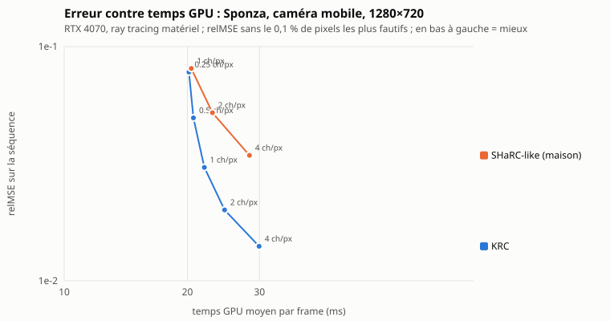

| 1280×720, relMSE* (static) | Sponza fixed camera | Sponza moving camera | Cornell 1024² moving camera |
|---|---|---|---|
| KRC 0.25 path/px | — | 7.8e-2 (7.4e-2) · 20.2 ms | 1.3e-2 (5.5e-3) · 8.4 ms |
| KRC 1 path/px | **2.3e-2** (1.0e-2) · 5.4 ms | **3.0e-2** (2.6e-2) · 22.0 ms | **4.8e-3** (1.5e-3) · 9.3 ms |
| NVIDIA SHaRC, 1 px/5×5 | 9.3e-2 (1.9e-2) · 0.8 ms | 1.4e-1 (3.0e-2) · 0.9 ms | 8.8e-2 (4.8e-3) · 0.9 ms |
| NVIDIA SHaRC, 1 px/1×1 | 7.0e-2 (**6.2e-3**) · 2.6 ms | 1.2e-1 (**9.0e-3**) · 3.3 ms | 8.9e-2 (2.0e-3) · 2.1 ms |
| NVIDIA SHaRC, voxels /2, 1 px/3×3 | 9.4e-2 (1.9e-2) · 1.2 ms | 1.4e-1 (2.9e-2) · 1.3 ms | 8.7e-2 (**1.8e-3**) · 1.0 ms |

Reading:

- **In static, the real SHaRC wins.** With a fixed or a moving camera, it reaches the same error as KRC, or better, for
  3 to 25× less GPU time. Its paths are much cheaper: 4 to 100 % of pixels updated, and paths cut from the 2nd or 3rd
  vertex by cache resampling.
- **On light changes, KRC clearly wins.** SHaRC propagates light one bounce per frame, reading itself back: after the
  large lamp switches off, it stays 7× too bright for dozens of frames. KRC measures the change through correlated paths.
  Over the full sequence, KRC therefore has 3 to 18× less error, but for 2 to 25× more time. **At equal time, no
  comparison is possible yet**: KRC's minimum cost exceeds SHaRC's total cost.
- **Not tested, and needed before concluding**: SHaRC's "responsive lighting" mode (`SHARC_ENABLE_RESPONSIVE_LIGHTING`),
  designed for lights that change fast.
- **KRC's cost with a moving camera** (`results/campaign_cam/passes.txt`, Sponza 1280×720, 0.25 path/px): 12.6 ms per
  frame, of which 5.8 ms of hash-table insertion (3.7 M insertions per frame, probes lengthened by tombstones) and 3.6 ms
  of resolve (all 1.35 M cells, visible or not, every frame). Fixed camera: 3.9 ms (resolve 1.0 ms, lookup 0.5 ms).
  SHaRC: 0.8 ms in all.
- **Memory**: 1.35 M live cells × ~340 bytes ≈ 460 MB for KRC, against a fixed 176 MB for SHaRC (2^22 × 44 bytes).

**What it changes for the hypothesis.** The moving camera does not invalidate KRC's quality, but the comparison with the
real SHaRC invalidates the idea that KRC is a better general cache: allocation by uncertainty costs more than it brings
against SHaRC's short and few paths. What stays solid is the **differential update through correlated paths** facing
lighting changes. Next hypothesis: a standard SHaRC for the steady state, and KRC's correlated corrections only at events.

## 13. KRC v2 against the real SHaRC

After §12, KRC was refined with short tests (`krc duel`, `krc static`; 480×270 or 256², 3 seeds, error then GPU time
without readback). Changes kept (KRC v2, default):

| Change | Origin | Effect |
|---|---|---|
| Insertion without useless CAS, list of visible cells, sweeping eviction | cost | 12.6 → 4.4 ms with a moving camera at 1280×720 |
| Resampling: stop at the 1st/2nd bounce on a cell (inherited dependencies) | SHaRC | −25 % error, −40 % time |
| 8 px cells instead of 4 | SHaRC (larger voxels) | more paths per cell |
| Prior from the neighbouring level for a new cell | SHaRC (level blending) | slight, moving camera |
| Material demodulation | SHaRC | slight |
| Target quality on the GPU (τ = 5 %) | KRC | static: cost drops once converged |

Tried without gain (options disabled): vertex reuse, off-screen support cells, K = 2, two-resolution cache, partial
recording of dependencies.

**Full sequences** (relMSE*, mean GPU time per frame):

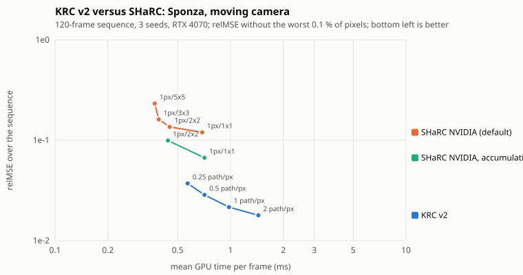

| At equal time | KRC v2 | NVIDIA SHaRC, defaults | NVIDIA SHaRC, accumulation 5 | Ratio |
|---|---|---|---|---|
| Sponza fixed camera, ~0.6 ms | **2.2e-2** | 7.5e-2 | 4.3e-2 | 1.9 to 3.4× |
| Sponza moving camera, ~0.7 ms | **2.9e-2** | 1.2e-1 | 6.7e-2 | 2.3 to 4.2× |
| Cornell fixed camera, ~0.3 ms | **2.6e-3** | 6.9e-2 | — | 27× |
| Cornell moving camera, ~0.3 ms | **3.2e-3** | 9.0e-2 | — | 28× |
| Sponza moving camera 1280×720, ~3 ms | **2.7e-2** (p95 5.0 ms) | 1.2e-1 (3.3 ms) | — | 4.4× |

**Long static** (fixed scene, fixed camera, 300 frames, `krc static`):

| | relMSE* f29 | f299 | ms/frame converged |
|---|---|---|---|
| Sponza, SHaRC 1 px/1×1 | **9.2e-3** | **6.1e-3** | 0.59 |
| Sponza, SHaRC 1 px/2×2 | 1.9e-2 | 1.2e-2 | 0.40 |
| Sponza, KRC v2 (8 px) | 1.1e-2 | 9.9e-3 | **0.34** |
| Sponza, KRC v2, 4 px cells | 1.1e-2 | 7.2e-3 | 0.47 |
| Cornell, SHaRC 1 px/1×1 | 5.5e-3 | 4.6e-3 | 0.17 |
| Cornell, KRC v2 | **2.0e-3** | **1.7e-3** | 0.17 |

Reading:

- **On dynamic sequences, KRC v2 wins at equal time, everywhere**, including against a SHaRC tuned to react fast. The gain
  comes from correlated paths at events, and resampling removed most of its cost lag.
- **In static, it is split.** Cornell: KRC 2.7× better at the same cost. Sponza: KRC slightly better at low cost
  (0.34 ms), SHaRC better at 0.6 ms (6.1e-3 against ~7e-3). With a moving camera at 1280×720, the static phase stays in
  SHaRC's favour (9.0e-3 against 2.0e-2 at 3 ms).
- **Minimum cost**: at 1280×720, KRC v2 does not go below ~3 ms (G-buffer, table, resolve, display), SHaRC runs from
  0.9 ms. Event peaks remain (p95 5 ms at 0.25 path/px).
- **Not tested**: SHaRC's experimental "responsive lighting" mode (not used by NVIDIA's sample; the lights concerned must
  be flagged in advance). The short accumulation window stands in for it here.

## 14. "Game-like" test: final image and denoiser

In a game, the cache is not displayed: each pixel computes its direct lighting, the cache provides the indirect, then a
denoiser runs. Identical pipeline for both methods (`krc game [scene]`, `src/game.wgsl`, 3 seeds):

- **KRC**: per-pixel direct lighting (one direct estimate per frame) + indirect light read from the cells, which now store
  only the indirect;
- **SHaRC**: its official Render pass (one path per pixel, cache at the next bounce);
- **shared denoiser** (simplified SVGF): temporal accumulation of the demodulated illumination with reprojection, history
  clamped by the variance of the 3×3 neighbourhood, three à-trous filters guided by normal and position. Its cost is
  counted.

| Final denoised image, relMSE* (static) · GPU | KRC v2 0.5 p/px | SHaRC 1 px/1×1 | SHaRC acc. 5, 1 px/1×1 | SHaRC 1 px/5×5 |
|---|---|---|---|---|
| Sponza fixed camera | **2.0e-2** (1.7e-2) · 0.89 ms | 3.5e-2 (1.4e-2) · 0.91 ms | 2.8e-2 (**1.2e-2**) · 0.91 ms | 3.8e-2 (2.2e-2) · 0.68 ms |
| Sponza moving camera | **2.1e-2** (2.0e-2) · 1.01 ms | 6.4e-2 (2.0e-2) · 1.03 ms | 4.6e-2 (**1.9e-2**) · 1.04 ms | 5.5e-2 (2.9e-2) · 0.78 ms |
| Cornell fixed camera | **5.4e-3** (**8.1e-4**) · 0.43 ms | 3.2e-2 (3.8e-3) · 0.44 ms | 2.8e-2 (3.2e-3) · 0.36 ms | 3.2e-2 (3.9e-3) · 0.37 ms |
| Cornell moving camera | **5.0e-3** (**1.8e-3**) · 0.43 ms | 3.6e-2 (5.2e-3) · 0.39 ms | 3.2e-2 (4.5e-3) · 0.39 ms | 3.4e-2 (5.4e-3) · 0.32 ms |

| After the large lamp switches off (lum: 1 = right) | f101 | f103 | f110 |
|---|---|---|---|
| Sponza fixed, KRC 0.5 | 1.00 | 0.84 | 0.73 |
| Sponza fixed, SHaRC 1×1 | 1.72 | 1.62 | 1.48 |
| Sponza moving, KRC 0.5 | 1.43 | 1.08 | 0.87 |
| Sponza moving, SHaRC 1×1 | 6.27 | 5.73 | 5.42 |
| Cornell fixed, KRC 0.5 | 1.10 | 1.07 | 1.02 |
| Cornell fixed, SHaRC 1×1 | 1.71 | 1.61 | 1.48 |

Reading:

- **The denoiser must clamp its history.** Without clamping, it dragged the switched-off lamp along (lum 2.4 instead of
  1.0) and erased KRC's advantage. With it, KRC keeps its responsiveness.
- **At equal time, on the sequences, KRC v2 wins**: 1.4 to 3× less error on Sponza (against the best SHaRC, responsive
  included), 4.5 to 5.7× on the Cornell box.
- **In static, it is split**: KRC clearly better on the Cornell box (2.5 to 3.6×); on Sponza, SHaRC slightly better with a
  fixed camera (1.2 to 1.35×) and level with a moving camera. To the eye, SHaRC keeps a bit more fine detail (the bounce
  traced per pixel), KRC is softer.
- **Without a denoiser**, the KRC image is 2 to 7× less noisy (its indirect is read from the cache, not traced per pixel):
  1.5e-1 against 2.9e-1 on Sponza, 2.2e-2 against 1.6e-1 on the Cornell box.
- **Visible KRC defect**: after Sponza's large lamp switches off, the image is more correct on average but **blotchy**
  (each cell corrected by 8 correlated paths keeps its own noise) and drifts toward dark (0.73 at f110; the denoiser's
  clamp, on a heavy-tailed input, contributes). SHaRC is uniformly too bright but clean. A player would see the blotches.
- Limits of the test: simple denoiser (not NRD), 480×270 and 256², flicker measured only with a fixed camera (KRC 0.004
  against 0.005–0.007 for SHaRC on Sponza).

## 15. Game pipeline after fixes

Fixes (JOURNAL v14): "total + direct share" cells instead of "indirect only" (the direct recomputed at the read-back vertex
added useless noise), 32 correlated paths per cell for a lamp. Same denoiser for both methods, at two settings of the
history clamp (1.5 and 3 standard deviations). 3 seeds, `results/game_final`.

| Final image, relMSE* sequence (static) | KRC 0.5 p/px | SHaRC 1×1 | SHaRC accumulation 5, 1×1 | Sequence ratio |
|---|---|---|---|---|
| Sponza fixed, clamp 1.5 | **1.59e-2** (1.42e-2) · 0.88 ms | 3.46e-2 (1.36e-2) · 0.90 ms | 2.76e-2 (**1.25e-2**) · 0.89 ms | 1.7× |
| Sponza fixed, clamp 3 | **1.58e-2** (1.24e-2) · 0.94 ms | 4.18e-2 (8.4e-3) · 0.90 ms | 3.28e-2 (**7.8e-3**) · 0.89 ms | 2.1× |
| Sponza moving, clamp 1.5 | **2.10e-2** (1.99e-2) · 1.01 ms | 6.38e-2 (1.96e-2) · 1.03 ms | 4.59e-2 (**1.86e-2**) · 1.02 ms | 2.2× |
| Sponza moving, clamp 3 | **1.85e-2** (1.83e-2) · 1.03 ms | 8.08e-2 (1.60e-2) · 1.03 ms | 6.11e-2 (**1.55e-2**) · 1.02 ms | 3.3× |
| Cornell fixed, clamp 1.5 | **5.3e-3** (**9.5e-4**) · 0.48 ms | 3.2e-2 (3.8e-3) · 0.45 ms | 2.8e-2 (3.2e-3) · 0.46 ms | 5.3× |
| Cornell moving, clamp 1.5 | **5.1e-3** (**2.0e-3**) · 0.48 ms | 3.6e-2 (5.2e-3) · 0.38 ms | 3.2e-2 (4.5e-3) · 0.37 ms | 6.3× |

Reading:

- **On the sequences, KRC wins at equal time everywhere**: 1.7 to 3.3× on Sponza, 5 to 6× on the Cornell box, against the
  best SHaRC (responsive included), at the same denoiser setting.
- **In static**: KRC 1.9 to 4× better on the Cornell box; on Sponza, SHaRC stays better, by 1.1× (clamp 1.5) to 1.6×
  (clamp 3).

- **After the large lamp switches off**: KRC at the right luminance within 1 frame (1.00–1.16), then a dark drift
  (0.74–0.81 at f110); SHaRC 1.5 to 7× too bright for dozens of frames. KRC's blotches have clearly decreased but are still
  visible at f119.
- **Peaks**: KRC's p95 1.3 to 1.9 ms against 0.9 ms for SHaRC at 480×270.

## 16. Showcase: the difference to the eye

`cargo run --release -- showcase 960` (after `sh tools/fetch_sponza.sh`): textured, glossy Sponza (polished, almost mirror
floor, satin stone, metal, a rolling chrome sphere, a golden sphere), a sky above the roof that sets at frame 100, a gallery
lamp switching on at frame 80, a walking camera. Same game pipeline for both methods, at equal GPU time (~5.5 ms at
960×540 without readback). Videos: `results/showcase/comparison.mp4` (24 fps) and `comparaison_lente.mp4` (12 fps); stills
`comparaison_f039/060/090/110.png`.

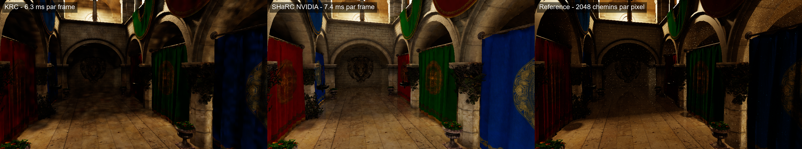

| relMSE* against the reference (2,048 paths/px) | KRC | NVIDIA SHaRC |
|---|---|---|
| Static, sky (f39) | 8.8e-3 | **6.4e-3** |
| The sphere rolls (f60) | 1.8e-2 | **1.3e-2** |
| Right after the sky sets (f101) | **2.4e-3** | 4.9e-3 |
| 10 frames later (f110) | **6.6e-4** (lum 0.98) | 1.5e-3 (lum 1.56) |
| Sequence | 9.9e-3 | **8.0e-3** |

After the white-dot fixes (JOURNAL v16: truncated mean of cells, clamping of young cells, path regularisation for both
methods), the two images are very close to the eye in the bright phases.

Reading:

- **When the light changes, the difference shows immediately**: after the sky sets, KRC is dark and warm like the
  reference; SHaRC still shows daylight for dozens of frames (luminance 1.5 to 2.1× too high).
- **Bright still scene, or rolling sphere**: SHaRC is slightly better (1.4×). To the eye, both are close; SHaRC is a bit
  cleaner, KRC keeps a few dark blotches. Over the whole sequence, SHaRC therefore has the lowest mean error.
- **Reflections**: the mirror sphere stays noisy for both (one reflection ray per pixel); KRC renders it a bit less noisy
  thanks to its cells read at the reflected point.
- **Peaks**: switching on a lamp costs KRC 12.6 ms (16 correlated paths per cell); SHaRC has a flat cost.
- The luminance ratios of the bright phase (0.3 to 0.7 for both) come mostly from the reference's fireflies (2,048
  paths/px, small lamps and glossy floor), not from the methods.

## 17. Showcase after fixes: banners, brightness, mirrors

Same conditions as §16 (`cargo run --release -- showcase 960`), after the fixes of JOURNAL v17. KRC: 16 px cells, 0.4
path/px, 2 direct estimates per pixel; SHaRC: §16's settings. The denoiser, the MIS and the specular clamp are shared.

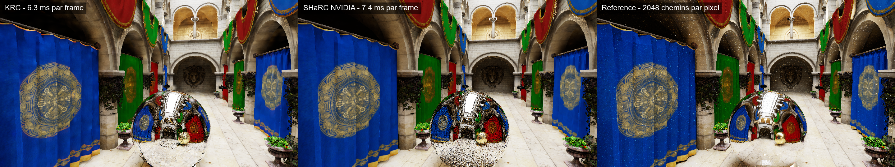

| Against the reference (2,048 paths/px) | KRC | NVIDIA SHaRC |
|---|---|---|
| Displayed PSNR, static (f39) | 22.6 dB | **24.2 dB** |
| Displayed PSNR, the sphere rolls (f60) | **21.4 dB** | 20.1 dB |
| Displayed PSNR, right after the sky sets (f101) | **22.3 dB** | 14.4 dB |
| Displayed PSNR, 10 and 19 frames later (f110, f119) | **26.1**, **27.0 dB** | 18.5, 19.9 dB |
| Luminance (f39 / f60 / f110) | 0.91 / 0.97 / 0.98 | 0.91 / 0.95 / 1.51 |
| Mean displayed PSNR over the sequence | **23.1 dB** | 22.5 dB |
| Mean GPU time, p95 | **6.3 ms**, **6.7 ms** | 7.4 ms, 20 ms |

Cell size sweep (KRC, same sequence): 6 px 21.2 dB (8.2 ms); 8 px 22.4 dB (7.2 ms); 12 px 22.7 dB (6.6 ms); 16 px 23.0 dB
(6.5 ms); 16 px at 0.4 path/px 23.1 dB (6.3 ms).

Reading:

- **Brightness**: both methods are now at the reference's level (0.91 to 1.05); the darkening came from the denoiser and
  from the sky missing in reflections, not from the caches.
- **Banners**: sharp golden borders for both.
- **Mirrors**: KRC's chrome sphere is clearly cleaner than SHaRC's (the reflection is read from the cells, off screen
  included); some blur remains when the sphere fills the screen (f81: relMSE* 0.28 against 0.25), as the specular history
  follows the surface and not the reflection.
- **Static**: SHaRC stays better (1.6 dB at f39); KRC keeps cell-sized blotches.
- **Events**: KRC 8 dB ahead after the sky sets; SHaRC keeps daylight (luminance 1.5).
- The mean relMSE* (KRC 7.4e-2, SHaRC 7.2e-2) is dominated by the edges of the sky's reflections in the sphere (f60 to
  f90); see JOURNAL v17.
- Non-regression (`game cornell`, `game sponza`, scenes without specular): unchanged, KRC 3.6e-3 against 1.4e-2 (Cornell),
  1.27e-2 against 2.26e-2 (Sponza). KRC's dark drift after switching off in `game sponza` (luminance 0.63 at f110) is still
  to fix.

## 18. In a real game: Quake II RTX

Quake II RTX (NVIDIA, Vulkan path tracing), demo `q2demo1` (a real recorded game), RTX 4070, 1280×720. The three methods
differ only in indirect lighting (`pt_cache`); everything else is the game's engine. Tools: `python tools/q2rtx/capture.py`
(images and fps), `python tools/q2rtx/lag_test.py` (reaction to a light cut).

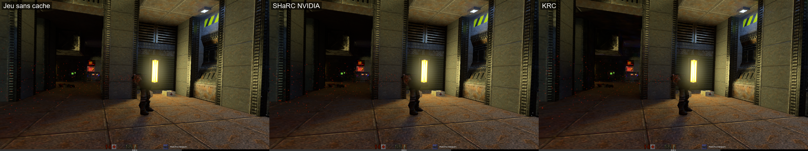

| Full demo (timedemo) | Game without cache | NVIDIA SHaRC | KRC (0.1 path/px) |
|---|---|---|---|
| Frames per second | 255 | 228 | 226 |
| Cache time (ms/frame) | — | 0.53 | 0.54 |
| Indirect bounces (ms/frame) | 0.69 | 0.61 | 0.63 |
| Denoiser (ms/frame) | 0.93 | 0.91 | 0.84 |

Reaction to a power cut (frozen demo, every lamp at 15 %, frozen exposure; PSNR against the game's reference, accumulated
in pause with the same camera):

| PSNR (dB) after the cut | +1 frame | +2 | +4 | +16 | +64 |
|---|---|---|---|---|---|
| Game without cache | 28.5 | 28.9 | 29.3 | 29.3 | 29.3 |
| NVIDIA SHaRC | 27.6 | 28.0 | 28.2 | 28.8 | 28.8 |
| **KRC** | **28.8** | **29.1** | 29.2 | 29.2 | 29.2 |

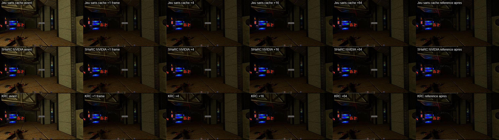

Reading:

- **On a still image, the three methods look alike** (PSNR of 37 to 48 dB between them, invisible to the eye): in Quake II
  RTX, the image is dominated by direct lighting, computed per pixel by the game, and the indirect goes through a powerful
  denoiser.
- **After a light change**, KRC is the most correct from the next frame; SHaRC keeps the old light for more than 64 frames
  (ceiling too bright). The game without a cache reacts fast too (a single bounce, recomputed every frame) and stays the
  closest to the reference, which is its own renderer (two bounces): both caches add bounces the reference does not have.
- **Cost**: equal to SHaRC. The integrated denoiser removes the lag added to the indirect, but saves little time here.

## 19. Reflections and a KRC-driven denoiser (Quake II RTX)

Two fixed views of `demo1` rich in reflections (reflecting water), the same moment for every method, reference: full
8-bounce paths, accumulated (`python tools/q2rtx/views.py`).

| PSNR (dB) against the reference | Red room, water floor | Outdoor pool |
|---|---|---|
| Game without cache | 36.2 | **32.3** |
| NVIDIA SHaRC | **36.5** | 32.1 |
| KRC | **36.5** | 30.4 |
| *Accumulated, bias only: game / SHaRC / KRC* | *44.8 / 45.3 / **45.8*** | *41.5 / 41.0 / **42.9*** |
| *True specular everywhere (`pt_fake_roughness_threshold 1`)* | *37.1 / 37.2 / 36.8* | *32.0 / 31.9 / **32.1*** |

Power cut (frozen demo, lamps at 15 %):

| PSNR (dB) | +1 frame | +2 | +4 | +64 |
|---|---|---|---|---|
| Game without cache | 28.5 | **29.6** | **30.2** | **30.7** |
| NVIDIA SHaRC | 27.9 | 28.3 | 28.7 | 30.1 |
| KRC | **28.7** | 29.4 | 30.1 | **30.7** |

Frames per second on the full demo (1280×720): game 279, SHaRC 227, KRC 210.

Reading:

- **KRC's cache is the most correct** (bias only: +0.5 to +1.9 dB over SHaRC).
- **Final image**: the three methods are within 0.5 dB, except outdoors with the game's fake specular (KRC −2 dB): this
  denoiser shortcut, tuned on the game's one-bounce indirect, exaggerates with a multi-bounce indirect. With true specular,
  KRC is ahead again.
- **Reaction**: KRC best at the first frame, SHaRC clearly behind; the game without a cache (a single bounce, recomputed
  every frame) catches up from +2.
- **Cost**: KRC is 7 % slower than SHaRC since the relighting's shadow ray was added.

## 20. Path-traced Doom (PrBoom+ RT, RTGL1)

KRC and NVIDIA's official SHaRC SDK plugged into RTGL1 v1.1.1, PrBoom+ RT's engine (a `krc` branch, patches in
`third_party/rtgl1_krc_patches`), shareware Doom. Measured in a session frozen with the Pause key
(`python tools/doomrt/bench.py --maps 1 2 3 --env KRC_PPP=0.05 KRC_EMIT_PHYS=1`): the methods take turns on the same image,
frozen exposure; reference: full 8-bounce paths, **accumulated in spherical harmonics inside the engine**; PSNR outside the
player's weapon; every lamp cut to 10 % (`light=0.1`); 1280×720.

| PSNR (dB) | Still image | +1 frame | +32 | +250 | GPU |
|---|---|---|---|---|---|
| **E1M1** game / SHaRC / KRC | 47.1 / **50.7** / 50.1 | 33.1 / 33.3 / **36.0** | 38.5 / 39.1 / **42.6** | 44.6 / **50.1** / 46.1 | 3.98 / 3.48 / 3.54 ms |
| **E1M2** | 46.7 / 44.0 / **47.5** | 33.4 / 32.6 / **37.9** | 35.5 / 35.8 / **39.8** | 42.8 / **43.0** / 42.3 | 4.41 / 3.99 / 4.03 ms |
| **E1M3** (room lit by emissive panels) | 49.5 / **50.5** / 46.3 | — | — | — | 3.65 / 3.12 / 3.23 ms |

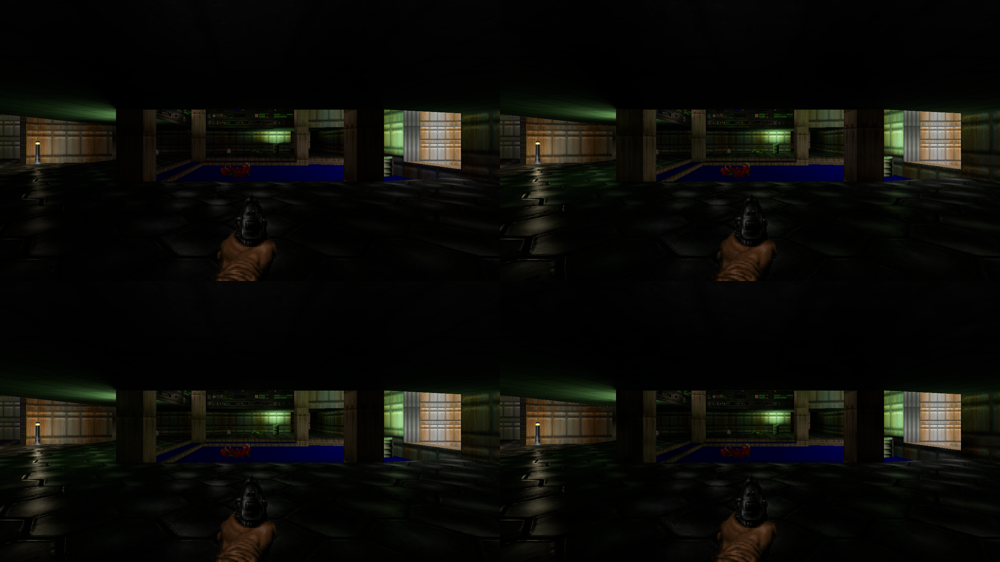

Reading:

- **Reaction**: KRC is clearly ahead after a light change (+2.7 to +5.3 dB the next frame, +3.5 to +4 dB at +32), thanks
  to exact relighting by light groups and the dialogue with the denoiser. SHaRC and the game take 128 to 250 frames to
  come back.
- **End of convergence**: SHaRC gets ahead again at +128/+250 on E1M1 (−4 dB for KRC): the part of the change the groups
  do not explain stays a few hundred frames in the cells' mean.
- **Still image**: split (KRC ahead on E1M2, SHaRC on E1M1 by 0.6 dB, and clearly on E1M3 where light comes from emissive
  panels that KRC's paths must find by chance).
- **Cost**: level with SHaRC (+0.05 ms), 0.4 ms less than the game without a cache.

RTGL1 bug found and fixed (for every method): its denoiser's gradient sample read the lamps' old colour back; an intensity
change never reset the history. Original game on E1M1 after the cut: 21.4 dB at +1, 35.9 dB at +250; fixed: 33.2 and 39.9
(`results/doomrt/fix_gradient`, `KRC_FIX_GRADIENT=0` for the old one).

Two measurement pitfalls, fixed before these numbers:

- **Emission convention**: RTGL1 adds the emission seen at the first diffuse bounce without the bounce's weight (it counts
  cos² instead of cos); KRC and the reference weight it. Without `KRC_EMIT_PHYS=1`, which gives the same convention to the
  game and to SHaRC, KRC won 7 to 11 dB on E1M2/E1M3 for a reason that was not the quality of its cache.
- **Reference averaged after clamping**: averaging the final images of a noisy reference loses the energy clamped in
  bright areas (KRC looked +56 % too bright there).

## 21. NVIDIA's bench (RTXGI SDK): NRD, changing light, cost

The path tracer sample of NVIDIA's RTXGI SDK (DirectX 12, SHaRC v1.8.3 and NRD REBLUR integrated by NVIDIA), on a `krc`
branch (patches in `third_party/rtxgi_krc_patches`), rendered without a visible window. Reference: full paths accumulated
(2,048 frames, jitter off like NRD). ꟻLIP (NVlabs/flip, LDR, lower = better). Tools: `tools/rtxgi/compare.py` (still image),
`tools/rtxgi/event.py` (light change).

**Why KRC-A looked worse after NRD.** Decisive test: KRC-A without reading the parent gives exactly SHaRC's image (living
room: 0.0723 against 0.0723). But reading the parent does not damage the image: **the sample's NRD loses 9 to 15 % of
energy off-sky**, even in full path tracing without a cache (output / input ratio 0.913); SHaRC, 5 % too bright off-sky,
partly compensates; KRC-A, more correct, does not. At equal exposure (best factor for each), KRC-A equals or beats SHaRC:
living room 0.0636 against 0.0644. REBLUR's anti-firefly has nothing to do with it (turning it off: −0.003 for all). A
defect of the sample's NRD integration, still to find.

**Changing light** (sun 20 → 5 in the living room; off-sky luminance −19 %). KRC-L = SHaRC's table + exact relighting by
light groups (`Libraries/Krc/include/KrcRelight.h`); "relit history" = NRD's input divided by the product S of the factors
(smoothed on screen), output multiplied back.

| ꟻLIP after NRD | +0 | +4 | +16 | +32 | +64 | +128 | +512 |
|---|---|---|---|---|---|---|---|
| SHaRC | 0.113 | 0.116 | 0.118 | 0.118 | 0.113 | 0.095 | 0.067 |
| SHaRC, NRD cleared at the switch | 0.165 | 0.159 | 0.149 | 0.143 | 0.130 | 0.103 | 0.067 |
| KRC-L | 0.116 | 0.117 | 0.116 | 0.111 | 0.097 | 0.078 | 0.067 |
| **KRC-L + relit history** | **0.094** | **0.093** | **0.093** | **0.091** | **0.086** | **0.078** | 0.067 |

Raw image (off-sky luminance / reference): SHaRC 1.22 at the switch, 1.08 at +128; KRC-L 1.05 from frame 0, i.e. its final
level. NRD's history confidence (`IN_DIFF_CONFIDENCE`) helps little: REBLUR only brings the history back to one frame, and
the old lighting still weighs 50 %.

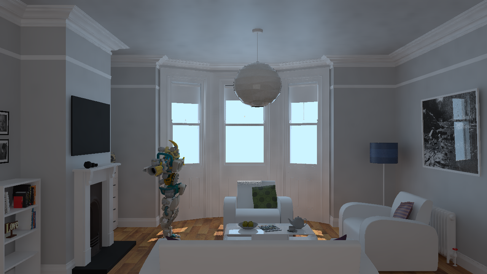

**Bistro lamps at night** (4 point lamps added, group A from 100 % to 20 %; image ×3 darker): raw, KRC-L correct from frame
0 (0.999 against 1.108 for SHaRC, caught up at +128). After NRD, small gain: NRD reacts on its own to such a strong change,
and the relit history darkens 6 % too much (a per-cell ratio, while pixels close to a lamp change more).

**Still image**: KRC-L = SHaRC (living room 0.0742 against 0.0730, within a session's spread; Bistro identical). **Cost**
after optimisation (living room, 1280×720): SHaRC 3.85 ms, KRC-L 3.86 to 3.90 ms, KRC-A 4.09 ms. Before, 5.84 ms: the
per-entry passes cleared the table's 4 M entries every frame; they now clean only at eviction.
